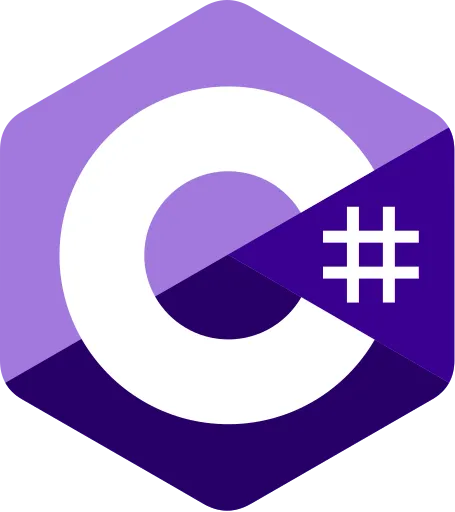
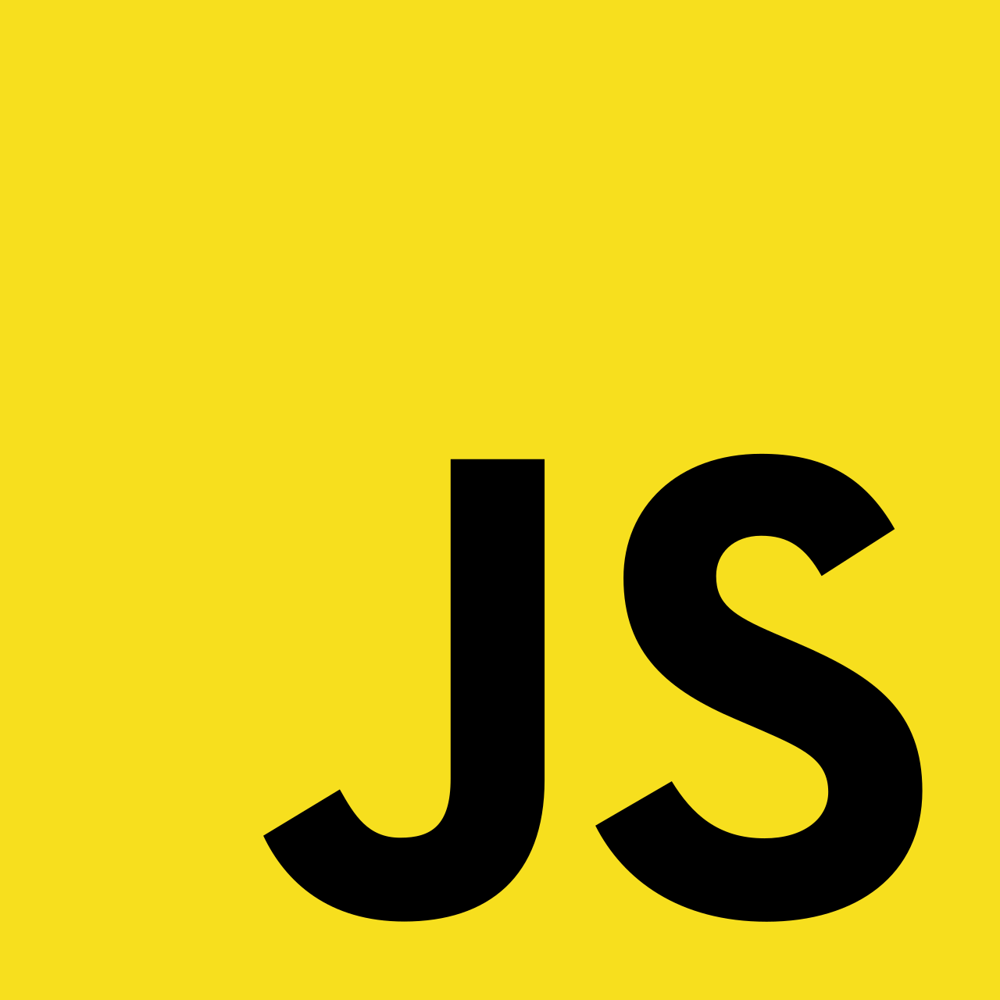
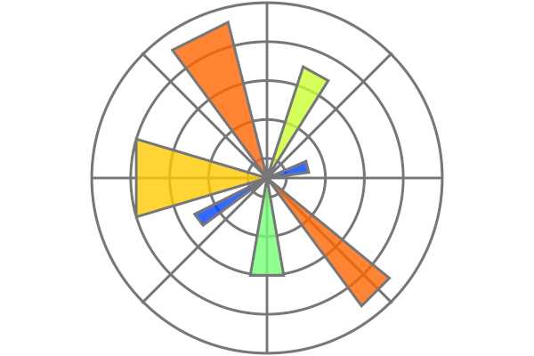

# Profile info
Hi! Cody is not my real name, and here is some stuff about me:

- I started coding 3 years ago
- My first language was C# and my second was Python
- I took a really long coding break and forgot how to code
- For Java I use Eclipse IDE and for every other language I use Visual Studio Code (or OSS on linux)
- I use Arch Linux with KDE as my OS (btw)
- I know Cybersecurity
- I make games with Unity and I'm planning on learning Godot
- I'm learning how to draw
- My favorite color is lime green
- Here are my top 4 favorite languages:
  - #1 Lua (really underrated)
  - #2 Java
  - #3 Python
  - #4 Typescript

## My abilities
My abilities are quite limited but here are some languages and frameworks I know:

  
  
  
  
  
  
  
  
  
  
  
  
  
  
  
  
  
  
  
  
  

